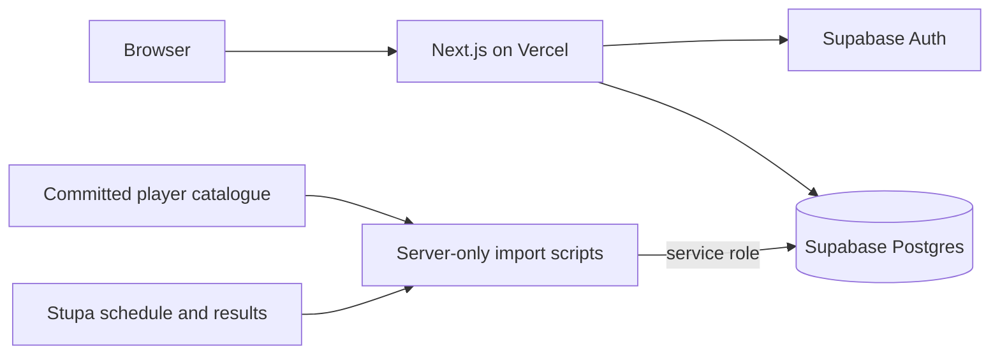
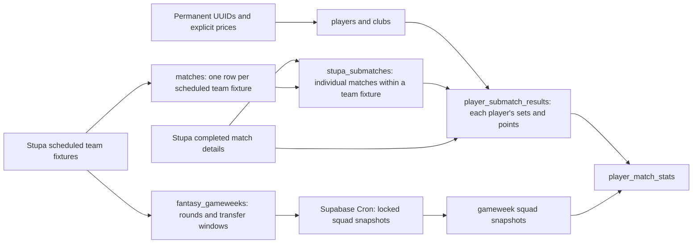

# Architecture

Fantasy Pingisligan is a Next.js App Router application backed by Supabase Auth
and Postgres. Vercel can host the web application; data imports run separately
as trusted server-side jobs.

## Web application

- Server Components render routes and read data with the server Supabase client.
- Authentication checks use verified JWT claims through `auth.getClaims()`.
- Middleware refreshes the Supabase session cookies when necessary.
- The dashboard initially loads only the current fantasy team and its squad.
- Opening a player picker triggers `GET /api/players`; the player pool is not
  included in the initial dashboard render.
- The catalogue RPC `get_transfer_players` returns one compact statistics summary
  per active player. `GET /api/players/[playerId]` loads player history and the next
  three scheduled club fixtures only when a statistics dialog or squad actions
  popup opens. The squad popup reuses the statistics summary (price, form and
  ownership), recent form and upcoming opponents in a labelled Player overview
  section below its three-action Team action row. All overview cards use the
  same navy surface; compact spacing on short screens keeps actions reachable.
  A smaller remove action sits at the bottom left and the larger Full player
  statistics action sits at the bottom right. Both views share one bounded 60-second browser cache
  and in-flight request; the dashboard does not preload player histories. Both routes
  require verified authentication. Statistics appear in a dialog that preserves
  the transfer draft and filters. The outgoing card's identity and price, and
  player and statistic cells in the transfer list, open this read-only dialog;
  adding a player uses only
  the transfer window's add button. Result popups show the gameweek breakdown
  without a full-statistics action. Compact cards keep price, points, form and
  ownership percentage on one row on phones; info buttons open dismissible
  explanations. The next
  three opponents share one row with logos, names and gameweek/home/away labels.
  Recent form shows the last five finished gameweeks: missed weeks show `-`,
  while played weeks show their points, including zero. The Form
  summary still averages the last five finished gameweeks, including missed
  weeks as zero. Singles sets and their points are split by won/lost matches.
  Player statistics and transfer summaries include only gameweeks whose unlock time has passed and
  whose results/scoring refresh has completed, using the same completion marker
  as the local and production unlock flow. Inactive owned players retain their
  history but cannot be newly transferred in.
- Ownership percentages reuse the latest completed gameweek's locked squad
  snapshots, including starters and bench players. Teams without a snapshot
  are excluded. The shared catalogue RPC supplies the same percentage for the
  transfer table and player dialog; no per-player ownership requests are needed.
  Only aggregate percentages are public, never individual manager selections.
- The transfer picker sorts locally through clickable statistic column headers,
  toggling ascending/descending order with an arrow beside the active title.
  The Player header sorts by surname; names use a first initial and surname.
  Numbers in the active statistic column are white and other columns are muted.
  Price, form and ownership use equally sized columns on phones; wider screens
  also show points and singles win rate. Club logos sit beside player names,
  and transfer buttons show `+` or the reason a player cannot be added.
  When replacing a player, a compact card shows their club logo, name, club and
  price above the available-player count and sortable table. Only selected rows
  are highlighted; regular rows share a surface with subtle separators. The
  modal header, search and filters stay fixed while the outgoing card and table
  scroll together. The card reuses the catalogue or the owned player's existing
  data; opening statistics still loads details on demand.
- Squad changes use Server Actions. Every mutation rechecks authentication,
  transfer locks, ownership, squad rules and budget on the server.
- Supabase Row Level Security remains the database-level authorization boundary.
- Home shows the signed-in manager's profile display name under their team name.
  Global and private standings, search results and team dialogs show the same
  smaller secondary text. Standings RPCs join profiles in the existing query;
  missing or blank names omit the secondary line. Display names follow the
  existing public global-standings visibility; emails are never added to rows.
- Team owners can update only `name`, `onboarding_completed`, and `updated_at`.
  New teams must start with a 100m budget; only trusted server operations can
  adjust existing budgets. The complete-squad save RPC requires exactly one
  captain among the four starters before invoking the atomic save.
- Player merges, squad snapshots, chip maintenance, and scoring RPCs require
  `service_role` or a privileged database operator. API users cannot invoke
  these administrative paths to bypass squad validation or rewrite history.

## Data pipeline

The data sources have a required dependency order:

`fantasy_gameweeks` does not contain every fixture itself. It represents a
round and stores the first and last match times plus the transfer lock window.
The individual team fixtures are rows in `matches`, linked back to their
gameweek through `fantasy_gameweek_id`.

While a gameweek transfer window is closed, Supabase Cron calls the idempotent
`snapshot_locked_squads()` database function every five minutes. It creates one
snapshot header for every complete six-player team that existed at the deadline
and immutable player rows containing names, position, captain, price and club
data. An incomplete team is skipped and can enter for the first time in a later
gameweek. Repeated calls are safe because the snapshot tables use
team/gameweek/player keys and ignore conflicts. Later scoring must use these
rows rather than the live squad.
After the scheduled unlock time, transfers remain closed until the scheduled results job
has imported available STUPA results and scored them successfully. The results
importer then scores the oldest pending unlocked gameweek and atomically records
`fantasy_gameweeks.data_refreshed_at` with the locked chips as used, clearing
its refresh lock. Prices and budgets remain unchanged; the scheduled results
job never imports or reprices players.

Results are checked daily at 00:07 Stockholm time and additionally every 15
minutes at :07, :22, :37, and :52 from the first fixture start on each playing
day until five hours after that day's last fixture start, including across
midnight. Individual fixture dates drive this decision, including
when a gameweek spans several days. GitHub schedules only the nightly run, which
refreshes fixtures first. Supabase Cron checks the shared database window rule
every 15 minutes and dispatches GitHub only when due. A dispatched run checks
the same rule before importing. GitHub Actions runs may be delayed.

The Stupa schedule and completed results are two views of the same real-world
team fixtures. The schedule importer creates the parent `matches` rows before
play. After play, the results importer attaches the individual submatches and
per-player set/point details to those existing fixtures. The current results
importer stores source results and recalculates `player_match_stats` and
fantasy-team gameweek totals. Player eligibility depends on active status and
an explicit configured price; optional legacy rankings do not affect it.

Result persistence uses the service-role-only `persist_stupa_results` RPC, also
used by the synthetic lifecycle harness. It locks affected fixtures and
atomically replaces superseded STUPA IDs by fixture, singles/golden kind and
match order, together with their player results. Unobserved positions remain
intact; ambiguous incoming positions abort the transaction. Scoring and refresh
completion run only after successful persistence.

## Trust boundaries

Dashboard announcements use a persistent layout controller and the existing
Supabase clients/Server Actions. A compact per-user summary supplies popup
candidates and unread count; inbox history and content load on demand. Database
publication policies also guard private artwork. Dismissals and the 24-hour
Normal snooze persist per user without polling or publication jobs. See
[announcements](announcements.md) for publishing and reader behavior.

Public Supabase URL and anonymous keys may be used by the web app. The service
role key bypasses RLS and is restricted to local/server import jobs. Scraping,
source parsing and service-role writes belong in `scripts/`, a scheduled GitHub
Action, or another trusted server environment—not a Client Component.
