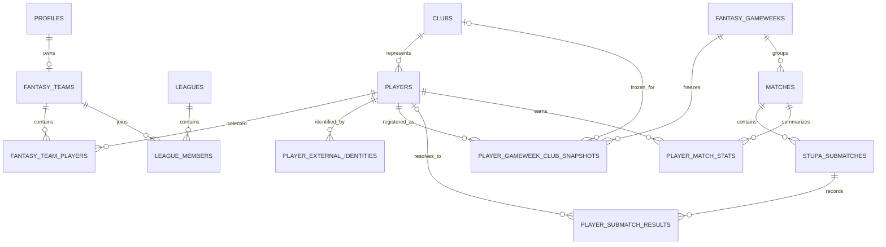

# Database model

`supabase/migrations/20260906000000_baseline_schema.sql` is the complete schema
baseline for a new Supabase project. Later timestamped files in that directory
move databases forward. See `docs/database-migrations.md` for the deployment
workflow. The files in `supabase/legacy/` are audit history from the former
manual process and must not be applied again.

## Main areas

- `profiles` mirrors application-specific user information from Supabase Auth.
  `created_at` records when the Auth user signed up, while nullable
  `verified_at` mirrors the time their email was confirmed.
- `fantasy_teams` is one user's team, name and budget. The budget represents
  current squad value plus unspent cash; it moves with owned-player price
  changes so a refresh does not change the team's available cash.
- `fantasy_team_players` is the six-player squad, including position and captain.
- `leagues` and `league_members` provide invite-only private leaderboards. The
  creator is added as the first member and can share the league's invite code.
- `fantasy_team_chip_selections` stores each team's pre-deadline chip pick for a
  gameweek, then records when that chip locks and when it is used.
- `players` and `clubs` contain catalogue data and explicit prices; rankings
  are optional legacy fields. A player's UUID remains
  permanent when an upstream license changes. `player_external_identities`
  maps historical and current SBTF license and Stupa role IDs to that UUID;
  `players.profixio_id` remains the current license for compatibility.
- `fantasy_gameweeks` is created from Stupa rounds. Its first and last match
  timestamps produce the transfer lock window; `data_refreshed_at` records when
  the post-gameweek results import and scoring has reopened transfers.
- `matches` contains the parent team fixtures required before results can load.
- `stupa_submatches` retains each source submatch and its raw payload.
- `player_submatch_results` retains per-player set and point details. Its
  `player_id` may be null when an imported identity cannot be matched.
- `player_match_stats` stores calculated singles, doubles, set, fixture-bonus,
  walkover and gameweek-bonus points derived from the raw Stupa rows.
- `player_gameweek_club_snapshots` freezes every player's club and active state
  when a gameweek locks. A player receives a historical fixture-win bonus only
  when imported results show that they appeared in the fixture and their frozen
  club won, so later transfers and imports cannot change an old gameweek during
  recalculation.

## Authorization and business rules

RLS is enabled on application tables. Public sports data has read policies;
team data is limited to its owner. Squad mutations go through one atomic RPC
and require exactly four starters and two bench players. Server Actions also
validate business rules such as one captain, budget and transfer lock.
An inactive player already owned by a team may remain at their preserved price,
but inactive players cannot be newly selected or re-added after transfer.
The two-players-per-club rule is also enforced by a database trigger so writes
outside the application cannot bypass it. Completed fantasy teams must have a
unique name, compared case-insensitively; unfinished teams may share the
placeholder name used during onboarding. A player-price trigger uses the latest
pending gameweek snapshot to preserve each completed team's cash when a player
from that squad is repriced. Squad and chip writes remain blocked until the
post-gameweek data refresh succeeds. The lock job skips incomplete legacy
squads, so their first complete squad enters the next available gameweek with
no transfer history from a missed gameweek.

The database functions `current_transfer_lock()`, `get_my_gameweek_progress()`,
`get_my_played_gameweek_progress()`,
`snapshot_locked_squads()`,
`calculate_player_match_stats()`, `calculate_fantasy_gameweek_points()` and
leaderboard-related RPCs provide
derived data to the application. Private league creation, invitation joining,
listing and rankings go through security-definer RPCs that verify the signed-in
user and league membership.

Leaderboard totals and per-team gameweek history use the same visibility rule:
a gameweek appears when its first fixture starts. Its score is live and may
change as result imports arrive. It becomes final only after the post-gameweek
refresh succeeds and records `fantasy_gameweeks.data_refreshed_at`. Stored
points for a future gameweek are excluded from totals and rankings.

## Player statistics

Migration `20261013162024_player_statistics.sql` adds two read functions without
changing scoring, stored results, prices or budgets. Forward migration
`20261013181253_publish_player_statistics_after_unlock.sql` restricts their
statistics to successfully unlocked gameweeks.

Migration `20261014154000_player_statistics_singles_sets_by_outcome.sql` extends
the weekly statistics RPC with singles sets won/lost and set points separately
for won matches and lost matches, using the same walkover normalization. It
recreates the RPC to extend its return type and restores its existing grants;
it performs no data writes and adds no database queries to the detail loader.

Migration `20261014173500_player_ownership_statistics.sql` adds
`get_player_ownership(p_player_id)` and extends the catalogue RPC with
`owned_percent`. Ownership is the percentage of locked squads containing a
player in the latest successfully completed/unlocked gameweek, including bench
players. The denominator is that game's squad snapshots; incomplete teams and
teams created afterward do not affect it. Percentages are rounded to one decimal,
with zero for an unowned player and null when no completed gameweek has team
snapshots. Transfers and in-progress weeks cannot change historical ownership.
The security-definer helper returns only player IDs and aggregate percentages;
private squad rows, team IDs and manager identities remain protected by RLS.
The catalogue materializes ownership once per request and keeps its existing
security-invoker boundary and grants. No stored scores or squads are changed.

- `get_player_statistics_rows(p_player_id)` returns weekly player points and
  singles/doubles wins and losses, singles sets and set points. It includes zero
  rows for missed unlocked gameweeks. A gameweek is included only after its
  first fixture starts, its unlock time passes and `data_refreshed_at` records
  successful results/scoring refresh. In-progress and pending-refresh results
  are excluded, even if raw results and calculated points already exist.
  An omitted player ID returns
  active-player aggregates for the transfer summary.
- `get_transfer_players(p_player_id)` adds total points, form, singles records and
  ownership to the public player catalogue. An explicit ID also permits historical details
  for inactive players. Form averages the last five unlocked gameweeks, or fewer
  at season start, including zero appearances; it is null before any week
  unlocks. Total points use `player_match_stats`, including existing bonuses and
  excluding fantasy-manager captain/chip/transfer adjustments.

The statistics helper is a security-definer function with an empty search path
and explicit anonymous/authenticated grants. It exposes only sports aggregates;
raw result payloads and personal fantasy data remain private. It classifies
doubles from the complete sides, including unresolved player identities, and
uses the scoring rules' walkover normalization. The catalogue function is a
security invoker. This permits anonymous-key public caching after the web app
has checked authentication, without introducing service-role credentials.

Statistics cover all imported gameweeks in the existing single-season model.
Upcoming fixtures are the current club's schedule, not a claim that the player
will participate. The
existing fixture query joins gameweek name/order for its home/away labels.
The recent form chart displays the last five finished gameweeks, showing `-`
for missed weeks and the points earned for played weeks, including zero.
Missed weeks still count as zero in the Form summary average.
