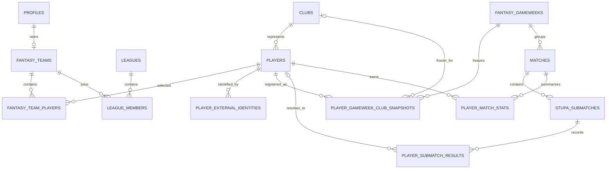

# Database model

`supabase/migrations/20260906000000_baseline_schema.sql` is the complete schema
baseline for a new Supabase project. Later timestamped files in that directory
move databases forward. See `docs/database-migrations.md` for the deployment
workflow. The files in `supabase/legacy/` are audit history from the former
manual process and must not be applied again.

## Main areas

- `profiles` mirrors application-specific user information from Supabase Auth.
  `created_at` records when the Auth user signed up, while nullable
  `verified_at` mirrors the time their email was confirmed.
- `fantasy_teams` is one user's team, name and budget. The budget represents
  current squad value plus unspent cash; it moves with owned-player price
  changes so a refresh does not change the team's available cash.
- `fantasy_team_players` is the six-player squad, including position and captain.
- `leagues` and `league_members` provide invite-only private leaderboards. The
  creator is added as the first member and can share the league's invite code.
- `fantasy_team_chip_selections` stores each team's pre-deadline chip pick for a
  gameweek, then records when that chip locks and when it is used.
- `players` and `clubs` contain catalogue data and explicit prices; rankings
  are optional legacy fields. A player's UUID remains
  permanent when an upstream license changes. `player_external_identities`
  maps historical and current SBTF license and Stupa role IDs to that UUID;
  `players.profixio_id` remains the current license for compatibility.
- `fantasy_gameweeks` is created from Stupa rounds. Its first and last match
  timestamps produce the transfer lock window; `data_refreshed_at` records when
  the post-gameweek results import and scoring has reopened transfers.
- `matches` contains the parent team fixtures required before results can load.
- `stupa_submatches` retains each source submatch and its raw payload.
- `player_submatch_results` retains per-player set and point details. Its
  `player_id` may be null when an imported identity cannot be matched.
- `player_match_stats` stores calculated singles, doubles, set, fixture-bonus,
  walkover and gameweek-bonus points derived from the raw Stupa rows.
- `player_gameweek_club_snapshots` freezes every player's club and active state
  when a gameweek locks. A player receives a historical fixture-win bonus only
  when imported results show that they appeared in the fixture and their frozen
  club won, so later transfers and imports cannot change an old gameweek during
  recalculation.

## Authorization and business rules

RLS is enabled on application tables. Public sports data has read policies;
team data is limited to its owner. Squad mutations go through one atomic RPC
and require exactly four starters and two bench players. Server Actions also
validate business rules such as one captain, budget and transfer lock.
An inactive player already owned by a team may remain at their preserved price,
but inactive players cannot be newly selected or re-added after transfer.
The two-players-per-club rule is also enforced by a database trigger so writes
outside the application cannot bypass it. Completed fantasy teams must have a
unique name, compared case-insensitively; unfinished teams may share the
placeholder name used during onboarding. A player-price trigger uses the latest
pending gameweek snapshot to preserve each completed team's cash when a player
from that squad is repriced. Squad and chip writes remain blocked until the
post-gameweek data refresh succeeds. The lock job skips incomplete legacy
squads, so their first complete squad enters the next available gameweek with
no transfer history from a missed gameweek.

The database functions `current_transfer_lock()`, `get_my_gameweek_progress()`,
`get_my_played_gameweek_progress()`,
`snapshot_locked_squads()`,
`calculate_player_match_stats()`, `calculate_fantasy_gameweek_points()` and
leaderboard-related RPCs provide
derived data to the application. Private league creation, invitation joining,
listing and rankings go through security-definer RPCs that verify the signed-in
user and league membership.

Leaderboard totals and per-team gameweek history use the same visibility rule:
a gameweek appears when its first fixture starts. Its score is live and may
change as result imports arrive. A successful post-gameweek refresh records
`fantasy_gameweeks.data_refreshed_at` and completes Fantasy's unlock processing;
postponed fixtures and later corrections can still change the scores. This is not
prize confirmation. Stored points for a future gameweek are excluded from totals
and rankings.

## Homepage banners and announcements

`competition_publication` centralizes enable controls in rows: `global` is the
master switch, `season` opts in the season prize, and `gameweek:<uuid>` rows link
individual Fantasy rounds through a unique `gameweek_id`. Each row has a readable
`name` and one `enabled` boolean. New gameweeks automatically receive disabled
rows; schedule upserts update labels while preserving choices. Deleting a round
cascades to its switch. No column is added for a new round or season.

`competitions_enabled()` reads global; `season_competition_enabled()` requires
global plus season. Public gameweek routes, prizes, terms, artwork and standings
require global plus their matching enabled gameweek row, with existing reveal and
readiness checks. Missing rows fail closed. Ordinary users can read these harmless
settings but cannot edit them. Fantasy scoring, entry deadlines, results refresh
and ordinary league standings remain independent. Centralization preserves all
existing choices and replaces the old per-gameweek column and season singleton
column without resetting data.

`homepage_banners` stores one automatically created draft row per Gameweek plus
an optional season row. Weekly `content_ready` and `prize_reveal_at` gate public
editorial reads. The date defaults to 18:00 Europe/Stockholm on the day after the
preceding Fantasy Gameweek's `last_match_ends_at`, with daylight saving handled
in SQL. Schedule imports preserve saved dates and copy. Clearing the date restores
the original Fantasy lifecycle gate and removes the fixed-date footer. Season
retains independent `published`/publication/expiry controls. Legacy weekly
publication values are preserved but no longer control visibility. All writes are
operator-only. `homepage_gameweek_states()` retains Fantasy lifecycle;
`homepage_prize_gameweek_states()` projects scheduled prize state for the
security-invoker Home/detail RPCs. The narrow security-definer
`get_public_gameweek_banner_schedule()` exposes only enabled Gameweek IDs,
public dates and reveal booleans. `get_homepage_competitions()` returns all history,
current, all generic future cards and season last. Artwork follows the same RLS
through the private announcement bucket. See [homepage highlights](homepage-banners.md).

Gameweek banner rows also hold an optional `teaser` (240 characters). It is
public before prize reveal and editable by operators alongside prize content.
New banner rows receive GW1–14 defaults; updates preserve custom or cleared copy.
The security-definer `get_public_gameweek_teasers()` returns only Gameweek IDs
and public teaser text for enabled competitions, using a default if no banner
row exists. It does not expose draft prize fields or artwork. Home's existing
security-invoker RPC keeps its prize RLS checks and returns teaser copy through
its legacy `cta_label` output, aliased to `teaser` by the app.

The same rows hold the `prize_title` headline for revealed Home banners and detail pages, long-form prize descriptions, prize-specific notes and separate
prize artwork for public competition pages. Legacy per-banner rules/eligibility text
is preserved as private shared-document drafts; the unused columns, stored CTA URL
and manual sort order are removed by the forward cleanup migration. `get_public_competition` uses the shared
RLS gate. `get_competition_standings` exposes only rank, team name and stored points;
weekly detail pages request five initial rows and fetch more on demand.
`private.weekly_competition_rankings()` orders entries by net Gameweek points,
raw captain points and cumulative season points through the selected round's
deadline. Later rounds are excluded. Complete ties share a rank and require a
manual draw. Search is applied after ranking so matches retain their competition ranks. An
authenticated-only `get_gameweek_leaderboard` projection adds the existing team
preview identifiers/display names for Leagues, using the same scored entries.
It and signed-in round metadata remain available with competitions disabled;
public prize/content/standings RPCs retain the launch gate.
Snapshot tables remain private. `get_weekly_competition_review` is operator-only,
applying the same captain/season comparisons without awarding prizes.
`competition_publication.competition_winner` is an operator-edited nullable
foreign key to `fantasy_teams.id`, restricted to Gameweek rows. Team deletion sets
it to null. It is editable through Table Editor with existing operator privileges;
application users cannot write it or read the private team ID directly. The public
`get_public_competition_winners` RPC returns the selected team's current name and
optional stored Gameweek points, gated by global/round publication and future
embargoes. No scoring or ranking validation chooses the winner. Changing or
clearing the column replaces or removes the announcement. The forward manual
winner migration removes the prototype decision table, confirmation/draw functions
and scoring triggers. See [Table Editor winner selection](competitions.md#choose-a-gameweek-winner-in-table-editor).

`competition_rules` stores shared Gameweek competition/Season Markdown documents with
operator approval and immutable versions. A banner's `rules_version_id` binds its
historical terms once; new approved versions never rewrite an existing binding.
`prize_value_sek` is an editorial approximate value, with no tax logic. Optional
`prize_product_url` stores an HTTPS external product link, independent of carousel
destinations and protected by the existing banner publication gate. Public RLS
reveals approved documents only through visible competitions. The separate
`get_current_competition_rules()` security-definer projection returns the latest
approved shared policy per enabled kind without requiring a banner reference.
Global and season switches still apply, and no draft or prize data is returned.
Numeric URL and
compact public-promotion RPCs reuse the same Fantasy numbers and visibility gates.

`announcements` stores scheduled, database-driven English content.
`announcement_user_state` stores private read/dismissal timestamps keyed by user
and announcement. The legacy `announcement_user_preferences` table and snooze
RPC remain unused; the app ignores snooze values. Ordinary users cannot modify
content or directly rewrite interaction state. Authenticated RPCs provide a
compact summary and irreversible interaction writes. Published due content remains
in the inbox after popup expiry; drafts/future content and their private Storage
artwork are protected by RLS. See [publishing](announcements.md).

## Player statistics

Migration `20261013162024_player_statistics.sql` adds two read functions without
changing scoring, stored results, prices or budgets. Forward migration
`20261013181253_publish_player_statistics_after_unlock.sql` restricts their
statistics to successfully unlocked gameweeks.

Migration `20261014154000_player_statistics_singles_sets_by_outcome.sql` extends
the weekly statistics RPC with singles sets won/lost and set points separately
for won matches and lost matches, using the same walkover normalization. It
recreates the RPC to extend its return type and restores its existing grants;
it performs no data writes and adds no database queries to the detail loader.

Migration `20261014173500_player_ownership_statistics.sql` adds
`get_player_ownership(p_player_id)` and extends the catalogue RPC with
`owned_percent`. Ownership is the percentage of locked squads containing a
player in the latest successfully completed/unlocked gameweek, including bench
players. The denominator is that game's squad snapshots; incomplete teams and
teams created afterward do not affect it. Percentages are rounded to one decimal,
with zero for an unowned player and null when no completed gameweek has team
snapshots. Transfers and in-progress weeks cannot change historical ownership.
The security-definer helper returns only player IDs and aggregate percentages;
private squad rows, team IDs and manager identities remain protected by RLS.
The catalogue materializes ownership once per request and keeps its existing
security-invoker boundary and grants. No stored scores or squads are changed.

- `get_player_statistics_rows(p_player_id)` returns weekly player points and
  singles/doubles wins and losses, singles sets and set points. It includes zero
  rows for missed unlocked gameweeks. A gameweek is included only after its
  first fixture starts, its unlock time passes and `data_refreshed_at` records
  successful results/scoring refresh. In-progress and pending-refresh results
  are excluded, even if raw results and calculated points already exist.
  An omitted player ID returns
  active-player aggregates for the transfer summary.
- `get_transfer_players(p_player_id)` adds total points, form, singles records and
  ownership to the public player catalogue. An explicit ID also permits historical details
  for inactive players. Form averages the last five unlocked gameweeks, or fewer
  at season start, including zero appearances; it is null before any week
  unlocks. Total points use `player_match_stats`, including existing bonuses and
  excluding fantasy-manager captain/chip/transfer adjustments.

The statistics helper is a security-definer function with an empty search path
and explicit anonymous/authenticated grants. It exposes only sports aggregates;
raw result payloads and personal fantasy data remain private. It classifies
doubles from the complete sides, including unresolved player identities, and
uses the scoring rules' walkover normalization. The catalogue function is a
security invoker. This permits anonymous-key public caching after the web app
has checked authentication, without introducing service-role credentials.

Statistics cover all imported gameweeks in the existing single-season model.
Upcoming fixtures are the current club's schedule, not a claim that the player
will participate. The
existing fixture query joins gameweek name/order for its home/away labels.
The recent form chart displays the last five finished gameweeks, showing `-`
for missed weeks and the points earned for played weeks, including zero.
Missed weeks still count as zero in the Form summary average.
